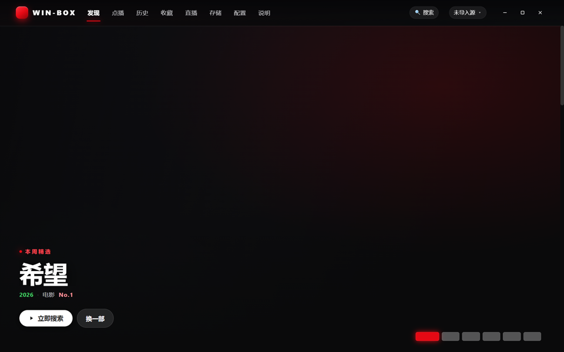
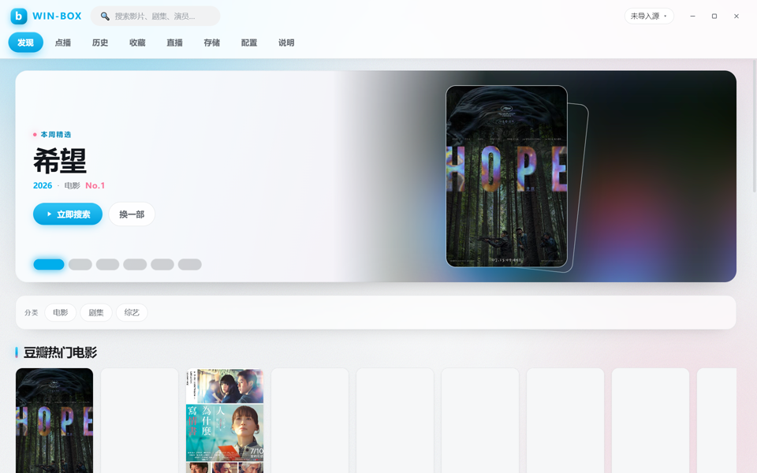
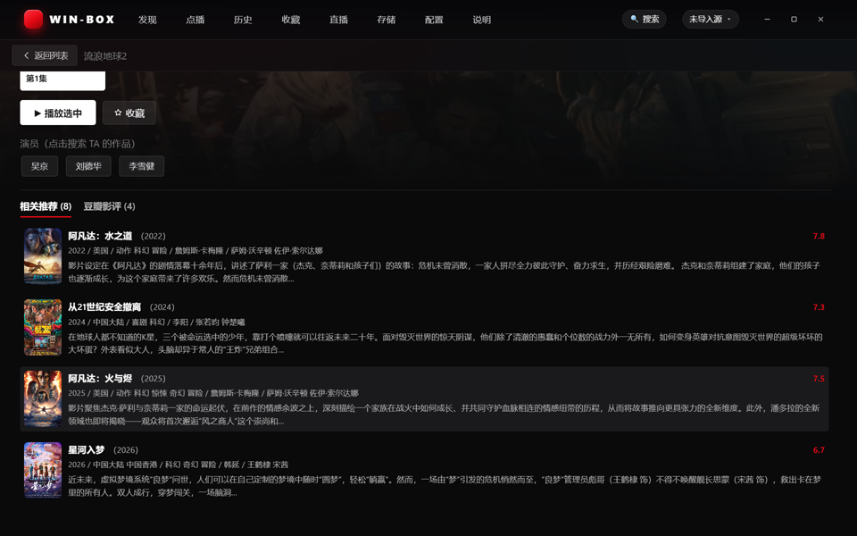

<div align=center>

<h1>Win-Box</h1>

</img>

<p>把安卓 TVBox移植到 Windows 的桌面播放器：导入你自备的站源 / 直播源，即可在电脑上搜索、浏览与播放。
原生支持 <code>jar</code> / <code>.js</code> / <code>.py</code> 三类蜘蛛、网盘播放与磁力 BT、弹幕、MPV 与 HTML5 双内核、四套皮肤。</p>

</div>

注：

由于Electron高占用的原因，本项目将不会继续更新，新项目将更换框架，[点此前往](https://github.com/yagami-hue/Kniephos)\
如果您觉得项目不错，欢迎加入交流群：[点此加群](https://t.me/kniephos)

如果喜欢该作品，也愿意帮助作者创作更好的作品：[点此赞助](https://afdian.com/a/WinBox)

## 支持平台

- Windows 10 及以上（x64）

## 屏幕截图

<table>
  <tr>
    <td></td>
    <td></td>
    <td></td>
  <tr>
  <tr>
    <td></td>
    <td></td>
    <td></td>
  <tr>
</table>

> 四套皮肤：网飝（网飞风）· 哔哔（B 站风）· 大果（Apple 风）· 大豆（豆瓣风）。

## 功能 / 开发计划

- [X] 站源导入（TVBox 站源 / 直播 txt·m3u，解析规则与安卓版逐字段一致）
- [X] 三类蜘蛛：`jar`（JVM 桥）· `.py`（嵌入式 CPython）· `.js`（node:vm 沙箱，含 drpy 风格）
- [X] 本地包源与网页源
- [X] 点播浏览：源分类 · 源筛选 · 翻页 · 跳页 · 无限瀑布
- [X] 全源搜索（边搜边出 · 按源筛选 · 搜索词缓存）
- [X] 发现页：豆瓣榜单 + 级联分类 + 首屏聚光卡
- [X] 详情页：剧集线路 · 演员 · 相关推荐 · 豆瓣影评（含全文独立窗口）
- [X] 播放内核：MPV 与 HTML5 一键切换
- [X] 网盘播放（夸克 / UC / 百度 / 115）+ 本机播放中继
- [X] 磁力 BT（边下边播 · 断点续传）
- [X] 解析接口与网页嗅探
- [X] 弹幕（多源可选 · 同集匹配 · 速度与透明度可调）
- [X] 直播（ 自定义直播源）
- [X] 投屏 DLNA · 外挂字幕 · 音频直通 · 倍速 · 跳过片头片尾 · 自动连播
- [X] 收藏 / 历史 / 播放进度记忆（返回零重载）
- [X] 四套皮肤 · 界面缩放 · 动效开关 · 老板键
- [X] 插件系统（开发者向：命令 / 快捷键 / 设置面板 / UI 槽位 / 播放内核）


## 下载

通过本页面 [Releases](https://github.com/yagami-hue/Win-box/releases/latest) 选项卡下载：

<a href="https://github.com/yagami-hue/Win-box/releases">
  
</a>

### Windows

- 下载 `Win-Box Setup x.y.z.exe` 安装版，双击安装即可（当前仅发布安装版）。
- 首次运行请先阅读并同意使用声明，再到「配置」页导入你自己的站源 / 直播源。

## Q&A

<details>
<summary>使用者 Q&A</summary>

#### Q: 为什么内存占用有几百 MB？

A: 本程序是 Electron（Chromium）桌面应用，四个 Chromium 进程本身的固有占用约 300MB，海报墙页面还会再叠加一部分图片解码与合成开销——这部分与具体播放内容无关。程序自身的数据结构与页面内容只占其中很小一部分，请在任务管理器中把本程序的多个进程合并看待。

#### Q: 为什么有的源打不开 / 搜不出结果？

A: 多数情况是源站自身的问题：站点已失效、需要 `ext` 配置、需要登录、或对接口做了加密。可以到「配置」页对该源点「诊断」查看详情；少数源依赖站点专有加密，属于无解源。换一个源通常即可正常使用。

#### Q: 为什么第一次进某个 Spider（jar / .py）源要等很久？

A: 这类源首次使用时要下载并转换运行时（jar → dex），耗时取决于网络，实测最长接近 200 秒。等待期间程序会自动重试，约 5 分钟内会自动出内容，无需反复手动点击。

#### Q: 为什么少数影片里有广告？

A: 本项目未插入任何广告。广告来自你导入的视频源或网盘里的文件本身，请不要相信其中的任何内容，并尽量选择干净的源与线路观看。

#### Q: 为什么弹幕搜不到，或者匹配到了别的集？

A: 弹幕接口普遍较慢且有抖动，程序已把超时放宽到 40 秒并并行拉取整季候选。匹配上采取**同集限定**：能识别出集号时只使用该集弹幕，识别不出时会明确标注「未确认是第 N 集」，同集确实没有弹幕时如实提示，不会静默显示别集。

#### Q: 为什么网盘播放要求先绑定？

A: 夸克 / UC / 百度 / 115 需要 Cookie 或扫码授权才能取到直链。绑定入口在「配置 → 凭据 → 网盘绑定」，播放时也会自动弹出提示。凭据只保存在你本机。

#### Q: 播放时画面突然消失、只剩声音？

A: 这是 GPU 进程崩溃（多见于显卡驱动 / 环境异常）。程序已内置恢复：检测到 GPU 进程崩溃后会重载最后播放的窗口，自动续播。

</details>

<details>
<summary>开发者 Q&A</summary>

#### Q: 为什么克隆下来直接编译跑不起来？

A: 仓库只包含**核心源码**，以下内容因体积、版权或合规原因不入库，需要自行准备：JDK / JRE、`stubs.jar` 桥、嵌入式 CPython、shell-shim、unidbg 运行时，以及第三方私有蜘蛛 jar。另有 `resources/mpv/`、`resources/ffmpeg/*.exe` 等随安装包分发的二进制也不入库。

#### Q: 想加一个自己的源 / 改点东西，从哪看起？

A: 引擎、主进程、渲染层分别在 `src/engine`、`src/main`、`src/renderer`，单测在 `tests/`（`pnpm test`）。改渲染层前请先 `pnpm run typecheck`（双 tsconfig）。

</details>

## 开发

```bash
pnpm install              # 依赖
pnpm test                 # Vitest 引擎单测
pnpm run typecheck        # 双 tsc 类型检查
pnpm run dev              # 开发（vite + esbuild watch + electron）
pnpm run build            # 构建（主进程 + 渲染层）
pnpm run dist             # 打包安装版
```

运行时依赖（**不入库**，按需自行准备）：JDK / JRE、`stubs.jar` 桥、嵌入式 CPython、shell-shim、unidbg 运行时等。

## macOS 版本

macOS 适配已合入主分支，与 Windows 共用同一份源码与同一个 Release（tag = `release<版本号>`）。

- **打包只能在 Mac 上做**：`pnpm icon:mac`（生成 `build/icon.icns`）→ `pnpm dist:mac`（产出 arm64 + x64 的 dmg 与 zip）。
- 依赖二进制（mpv / ffmpeg / ffprobe / aria2c / java / python3）**不入库**，需自备（`brew install` 或下载后放进 `resources/`）。
- 签名 / 公证 / 无开发者账号时的放行办法，全部见 **[`docs/macos-build.md`](docs/macos-build.md)**。
- macOS 上更新器会下载并打开 `.dmg`，提示手动拖入「应用程序」覆盖安装（未接入 Sparkle，不做静默替换）。

## 发布附件

当前更新器下载完整安装包，不使用 `.blockmap`；NSIS 配置已关闭差分包生成。
发布时仅上传当前版本的 `.exe` / `.dmg` 安装包，不上传 `.blockmap` 或构建元数据，也不要使用整个输出目录的通配符上传。

**资产命名必须严格一致**，否则更新器挑不到对应平台的安装包：

| 平台 | 文件名 |
| --- | --- |
| Windows | `Win-Box Setup <版本>.exe`（或 portable 的 `Win-Box <版本>.exe`） |
| macOS Apple Silicon | `Win-Box-<版本>-arm64.dmg` |
| macOS Intel | `Win-Box-<版本>-x64.dmg` |

```bash
pnpm run release:upload -- --dry-run  # 预览当前版本的上传文件，不执行上传
pnpm run release:upload              # 上传到已创建的 release<版本号>
```

上传脚本默认使用本机 `127.0.0.1:7897` HTTPS 代理加速 GitHub CLI；可用 `GH_UPLOAD_PROXY` 指定代理，设置为 `direct`（或 `none`）则直连。

上传命令读取 `package.json` 的版本和输出目录，只选择当前版本的 Setup / 可选 portable `.exe`；不自动创建 Release、修改正文或覆盖已有附件。
electron-builder 会规范化安装包文件名中的数字版本；上传脚本兼容规范化后的安装包文件名，Release 标签使用 `package.json` 的版本号。

## 目录结构

```
tvbox-win/
├── src/            # 四层：shared / engine / main / renderer
├── tests/          # 引擎单测（Vitest）
├── scripts/        # 构建与打包脚本
├── resources/      # js-lib + jvm 宿主源码（*.java，含 native-bridge 原生桥）
```

## 说明

- Fork 二改麻烦注明 Github 此项目，参考源码重新开发不必注明。
- 本仓库只包含核心源码；不含任何第三方私有蜘蛛 jar、JVM 运行时、逆向壳或专有产物。
- 本项目是**个人学习 / 研究性质的开源实现**，与安卓版及任何第三方站点、平台无隶属关系。

## 特别感谢

感谢 [TVBox / CatVod 上游](https://github.com/q215613905/TVBoxOS) —— 本项目的引擎规则与安卓版保持一致。

感谢 [mpv-Yaozhi](https://github.com/Yaozhil/mpv-Yaozhi) —— MPV 播放内核来自它的自编译构建。

感谢 [avbuild](https://github.com/wang-bin/avbuild) —— 随包的 FFmpeg 精简档来自它。

感谢 [aria2](https://github.com/aria2/aria2)（磁力 BT）、[hls.js](https://github.com/video-dev/hls.js) 与 [mpegts.js](https://github.com/xqq/mpegts.js)（HTML5 播放）、[dex2jar](https://github.com/pxb1988/dex2jar)（jar 蜘蛛运行时转换）。


特别感谢 Deepseek，GLM，GPT，CLAUDE等 —— 纯 Vibe coding 项目：本人 0 代码基础，包括开源与发布流程均由 AI 协助完成。

## 免责声明（请务必阅读）

1. **软件性质**：Win-Box 是开源学习项目，本质上只是一个**通用影片播放工具**（播放器外壳）；不含任何盈利行为，不提供服务、**不存储、不推送任何影视资源与内容**。
2. **不提供内容**：本项目**不内置任何资源索引、不运营任何内容服务器**。你自行配置 / 导入的播放源、直播源、弹幕与字幕接口、网盘凭据与内容，全部来自**第三方**，与本软件及作者无关；软件内的本地代理（`127.0.0.1`）仅用于你自己设备上的本机播放转发。
3. **无隶属关系**：与任何影视平台、内容站点、网盘服务、TVBox / CatVod 及其发行方**均无隶属、合作、代理或授权关系**；相关名称与商标归各自权利人所有。
4. **使用者责任**：请确保你导入的第三方源与使用行为**符合所在地法律法规**，不得用于传播、观看任何违法或侵权内容；因使用第三方来源引发的一切后果（含版权、侵权、内容合法性）由用户与第三方自行承担，作者免责。
5. **权利通知**：本软件不对任何第三方内容主张权利，也未从第三方内容中获利。若权利人认为本项目某项行为可能侵权，请通过 [Issues](https://github.com/yagami-hue/Win-box/issues) 联系，作者将及时核实并配合处理。
6. **无担保**：软件按**「现状」**提供，不附带任何明示或默示担保；作者不对使用或无法使用本软件造成的任何直接或间接损失负责。不接受上述约定请立即停止使用并删除本软件。

> 应用内「说明」页提供同一份声明的完整版。

## 隐私政策

我们不收集任何用户数据，不使用任何遥测组件。所有配置、历史、凭据与缓存都只保存在你本机。

## 许可

代码采用 MIT 许可证（见 [LICENSE](LICENSE)）。请遵守第三方软件（蜘蛛 jar、运行时、播放内核、壳等）各自的版权与许可。

## Star History

<a href="https://www.star-history.com/?repos=astrbotdevs%2Fastrbot%2Cwin-box%2Fwin-box%2Cyagami-hue%2Fwin-box&type=date&legend=top-left">
 <picture>
   <source media="(prefers-color-scheme: dark)" srcset="https://api.star-history.com/chart?repos=astrbotdevs/astrbot%2Cwin-box/win-box%2Cyagami-hue/win-box&type=date&theme=dark&legend=top-left" />
   <source media="(prefers-color-scheme: light)" srcset="https://api.star-history.com/chart?repos=astrbotdevs/astrbot%2Cwin-box/win-box%2Cyagami-hue/win-box&type=date&legend=top-left" />
   
 </picture>
</a>
